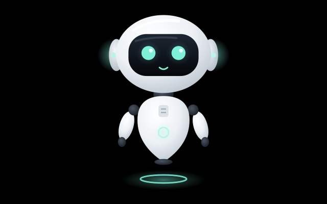

# Nabu

A voice skin for [Kiosk Satellite](https://github.com/jxlarrea/kiosk-satellite). While it is picked, your assistant is Nabu, a small hovering robot, instead of the usual overlay.

Nabu is drawn entirely in code; no pictures are shipped. It floats above a glowing hover ring and bobs gently, and its face screen shows round glowing eyes and a small mouth.

- **Resting:** it bobs, blinks and looks around with a small smile, its arms swaying gently.
- **Listening:** it lifts its arms a little, its eyes grow, a soft halo lights round them and its ear lights pulse with your voice.
- **Thinking:** it glances up and aside with one arm raised, three dots light up in turn and its chest ring chases round.
- **Answering:** happy arc eyes, and its arms, mouth, chest light and ear lights move with the answer.
- **Muted:** with the wake word muted, its ear lights glow red, its eyes close to low slits and its arms droop.

## Light on the device

Nabu was made to keep wake-ups quick on modest tablets:

- The parts that never move (shell, ears, face screen) are painted **once** into one picture, and each arm into a small one, at the exact size they are shown, ready from the moment the plugin starts, and kept between turns. Opening the overlay again costs next to nothing.
- Each frame draws that one picture, a few soft glows from one small sprite, and the face and lights as a handful of simple shapes.
- While Nabu rests it never draws faster than 30 frames a second. Nothing is drawn at all while the overlay is closed.

## Holidays

On holidays Nabu dresses up. Still decorations are painted once, like the robot itself, so ordinary days stay exactly as fast; only a few small things move (fireworks, twinkling bulbs, rising hearts, butterflies, a swaying lantern, candle flames).

| Holiday | When | Decoration |
| --- | --- | --- |
| Sinterklaas | first Saturday from 11 Nov – 5 Dec | three presents and pepernoten |
| Kerst | 6 – 26 Dec | a string of twinkling lights round the body, a small tree |
| Oudejaarsavond | 31 Dec | fireworks, oliebollen, champagne |
| Nieuwjaarsdag | 1 Jan | confetti, streamers, a sign with the year |
| Valentijnsdag | 14 Feb | heart eyes, rising hearts |
| Pasen | Goede vrijdag – Tweede paasdag | bunny ears, painted eggs |
| Koningsdag | 27 Apr (26 when the 27th is a Sunday) | orange crown, orange eyes, bunting, a tompouce |
| Bevrijdingsdag | 5 May | the Dutch flag, a dove |
| Hemelvaart en Pinksteren | Ascension Day, Whit Sunday and Monday | tulips and butterflies |
| Halloween | 31 Oct | witch hat, pumpkins, bats, orange eyes |
| Sint-Maarten | 11 Nov | a glowing paper lantern |
| Verjaardag | a household birthday | party hat, balloons, cake, and "Hoera, <name>!" over the conversation |

With **Holiday** on **Automatic**, a birthday comes first, then the **Public-holiday calendar** (a Home Assistant calendar such as the Dutch holidays one), then the plugin's own dates. The plugin knows the official dates too (Easter is calculated), so the calendar is optional.

Birthdays come from up to three date helpers named "Verjaardag <name>" (Settings > Devices & services > Helpers > Date and/or time, date only). Only the month and day count.

## On screen

Nabu follows **Overlay mode** in Kiosk Satellite's **Voice Satellite > Appearance**:

- **Full screen:** Nabu with the conversation beside it on a landscape screen, or below it on a portrait one: its name, what you said, the answer, and a line for each thing it did.
- **Docked:** a small bubble near the bottom with a little Nabu beside what you said and the answer, up to three lines.

## Settings

| Setting | What it does |
| --- | --- |
| Light colour | **Mint** (the default), **Cyan**, **Blue**, **Violet**, **Amber** or **Pink**: the eyes, ear lights, chest ring and hover ring, and the short lines around the answer. |
| Frame rate | **Auto** (the default) starts at full speed and drops to 30, then 20 fps on a device that can't keep up. **Full**, **30 fps** and **20 fps** fix the rate. Resting is never faster than 30 fps. |
| Arms | **Together** (the default): both arms move as one, mirrored. **Each its own**: a little out of step, with one arm raised while thinking. |
| Darkness | 0 to 100%: how dark the white shell is. Highlights stay bright. |
| Holiday | **Automatic** (the default), **None**, or one holiday to show every day, handy to preview them. |
| Public-holiday calendar | The calendar entity for the official Dutch holidays; **calendar.feestdagen_nederland** unless you change it. |
| Birthday helper 1–3 | Date helpers for birthdays, such as **input_datetime.verjaardag_anna**. Empty unless you pick one. |
| Name | The name over the conversation on a full screen, **Nabu** unless you change it. Leave it empty for none. |
| Answer font | **Kiosk Satellite** (its own font) or **Atkinson Hyperlegible**, designed to read easily. |
| Accent font | **Monospace** or **Same as the answer**, for the name, what you said and the actions. |

Nabu also follows the rest of **Voice Satellite > Appearance**: **Background**, **Text size** and **Reactive activity bar**.

## Requirements

- Kiosk Satellite 2026.10.30 or later
- The native Voice Satellite runtime turned on

## Installation

1. Every push builds a test ZIP: open **Actions > Build**, pick the latest run and download the `nabu` artifact (unzip it once; inside is `nabu-voice-skin-<version>.zip`).
2. In Kiosk Satellite's Remote Admin, use **Developer Tools > Install from ZIP** with that file.
3. In **Voice Satellite > Appearance**, set **Assistant 1 skin** (or **Assistant 2 skin**) to **Nabu**.

For a release, publish a GitHub release tagged with the version in `kiosk-satellite-plugin.json` (for example `v0.1.0`); the Release workflow attaches the installable ZIP, and **Add plugin** can then install it from this repository's URL.

## License and credits

Nabu is based on [Hovi](https://github.com/dlarkinsPonderosa/hovi-voice-skin) by Ponderosa. The code is [Apache-2.0](LICENSE). Changes from Hovi: the robot is a new, original design drawn in code (`RobotDrawer`), so Hovi's licensed artwork, holiday outfits and Robot Cat are not included; the plugin is renamed; there is a Light colour setting; the still parts are painted ahead of time and kept; and the frame rate is capped while resting. Files that came from Hovi say so at the top.

The fonts under `assets/fonts/` come from [Google Fonts](https://fonts.google.com), unmodified, each with its own licence beside it (SIL Open Font License 1.1).

The SDK under `sdk/` and the build tools under `tools/` come from [kiosk-satellite-plugins](https://github.com/jxlarrea/kiosk-satellite-plugins) (Apache-2.0).
